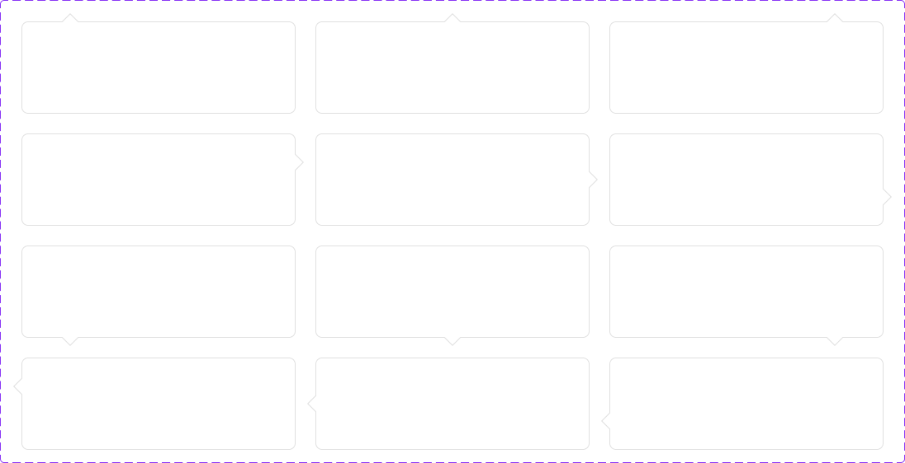
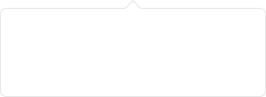
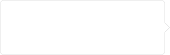
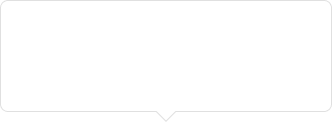
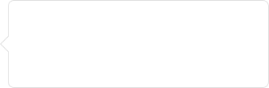

# Popover — Spec

**Figma:** [SDS Komponenter — Popover](https://www.figma.com/design/0aelUwbn2Ivir3T2JfhdOo/SDS-Komponenter?node-id=13309-24859&p=f&m=dev)
**Component folder:** `packages/design-system/src/Popover/`
**Replaces:** `@sikt/sds-popover` (Tooltip export dropped — out of scope for this component)
**Last synced:** 2026-11-24
**Sources:** `./figma.md`, `./research.md`, `./prior-art.md`
**Follow-ups:** `./followups.md`

> This spec describes **what Figma plans + what best-practice sources prescribe**, plus the design decisions resolved with the design-system owner. Implementation layout (file structure, CSS organisation, test strategy) is the implementation step's call.

## Resolved tradeoffs

Source-conflict resolutions recorded during synthesis.

- **Escape key dismisses the popover**
  - Figma: silent (no interaction states drawn).
  - Research: APG Disclosure pattern does not mention Escape; HTML Popover API mandates Escape dismissal for `popover="auto"`.
  - Prior art: legacy `@sikt/sds-popover` relies on the native `popover` attribute, so Escape dismissal comes for free.
  - Spec: Escape MUST close an open popover.
  - Reason: APG's omission describes generic in-flow disclosure; for a top-layer anchored surface, users expect platform behaviour.

- **Opening does not automatically move focus into the popover**
  - Figma: silent.
  - Research: HTML Popover API does not move focus; APG Disclosure is silent; Inclusive Components article unreachable.
  - Prior art: legacy `@sikt/sds-popover` does not move focus on open.
  - Spec: focus stays on the trigger when the popover opens. Consumers opt in by placing `autofocus` on an interactive child or moving focus from a `toggle` event handler.
  - Reason: the popover carries informational / interactive content on a non-modal surface; auto-focusing would surprise screen-reader users and conflicts with the Disclosure pattern where focus stays on the trigger.

## Design decisions

Decisions resolved against the 11 blocking open questions from the initial synthesis. Keyed back to the original question numbers for traceability with the three source files.

- **Q6 — Trigger ownership: consumer-owned (Dialog pattern).** Any element with `popovertarget={id}` opens the popover. SD3 Popover renders only the surface. `children` is the popover's content; there is no `target` prop.
- **Q4 — Non-modal only.** No focus trap, no backdrop, no `isModal` axis. For modal confirmations, use `Dialog`. APG pattern is Disclosure; platform is the HTML Popover API (`popover="auto"`).
- **Q7 — Positioning: `@floating-ui/dom` + `popover="auto"` for visibility.** Reversed from the initial "pure native CSS anchor-positioning" plan on 2026-11-24 after digdir confirmed they went through the same evaluation and chose FloatingUI due to cross-browser scroll-drift bugs. Of 15+ mainstream design systems surveyed, only GitHub Primer ships anchor-positioning (behind a feature flag, with JS fallback still default); Carbon, Fluent, and Ariakit all paused their explorations. `@floating-ui/dom` is tree-shaken to `computePosition` + `offset` + `flip` + `shift` + `limitShift` (~4kB gzipped). Arrow is a pseudo-element positioned via `--arrow-x`/`--arrow-y` CSS vars written by a custom middleware; `data-placement` on the root drives the rotation per side. Pattern borrowed from digdir's `packages/web/src/popover/popover.ts`.
- **Q8 — Placement API: `position` prop, typed union of 12 `position-area` values (physical form).** Mirrors `position-area` syntax directly so the component CSS is a 1:1 passthrough. Design-system boundary enforced via the union — consumers can't pass arbitrary `position-area` values.
- **Q9 — Default placement: `"top"`.** Centered above the trigger; FloatingUI's `flip` middleware re-orients on collision. Overrides Figma's default variant `Top start`; design-system-owner decision on 2026-11-24. ("No default, let the browser decide" was the interim decision while the component used CSS anchor-positioning — reversed together with Q7 when the implementation switched to FloatingUI.)
- **Q10 — No bundled close affordance.** Consumers wire dismissal themselves with `popoverTarget={id}` + `popoverTargetAction="hide"` on any `<Button>`. Reversed from the initial plan to mirror `Dialog.Close`; design-system-owner decision on 2026-11-24. Platform Escape + outside-click already covers the common case.
- **Q5 — Focus restore on close: track the invoker ourselves.** Browser only restores focus for `popovertarget`-opened popovers. SD3 Popover captures the previously-focused element on open (declarative or programmatic) and restores it on close. ~15 lines of hook code; consistent UX regardless of how the popover was opened.
- **Q11 — Hover/focus-open: out of scope.** SD3 Popover opens on click only. Hover-triggered / focus-triggered variants are a future `Tooltip` component (`popover="hint"` branch per the HTML Popover API).
- **Q1 — Figma binding conflict: trust live bindings.** Use `color/border/subtle` (`#E0E0E0` light / `#4D4D4D` dark) for `border-color` and `spacing/border/radius/md` (`8px`) for `border-radius`. The Anatomy annotation values (`#D6D6D6` / `12px`) are stale documentation — follow-up: ask designer to update the Specs frame text.
- **Q2 — Border width: bind to the house token.** Use `--sd3-space-border-weight-025` (`1px`) instead of hardcoding. Follow-up: ask designer to bind the Figma stroke to the matching variable.
- **Q3 — Arrow rendering: re-draw from the two surface tokens.** Two stacked triangles — `arrow-fill` using `color/surface/default-1`, `arrow-border` using `color/border/subtle` (1px larger than the fill). Rendering primitive (inline SVG / CSS triangle / clip-path) is the implementer's call. Follow-up: ask designer to re-draw the arrow in Figma as two tokenised shapes instead of a flattened export.

## Overview

An anchored, non-modal floating surface with a directional arrow that points back at its trigger element. Reach for it to surface short supplementary content, a small interactive affordance, or a brief form next to the element that produced it; do not reach for it for modal confirmations (use `Dialog`), for in-flow progressive disclosure (use `Details`), or for hover-triggered hints (future `Tooltip`).

The consumer owns the trigger: any element with `popovertarget={id}` opens the popover, matching the Dialog + Invoker Commands pattern already established in SD3.

## Variant axes

| Axis       | Values (typed union, 12 total)                                                                                                                                                                                   | Default                                   | Figma label mapping                                                                                                                                             | Notes                                                                                                                                                                                                                                                                                                  |
| ---------- | ---------------------------------------------------------------------------------------------------------------------------------------------------------------------------------------------------------------- | ----------------------------------------- | --------------------------------------------------------------------------------------------------------------------------------------------------------------- | ------------------------------------------------------------------------------------------------------------------------------------------------------------------------------------------------------------------------------------------------------------------------------------------------------ |
| `position` | `"top span-right"`, `"top"`, `"top span-left"`, `"right span-bottom"`, `"right"`, `"right span-top"`, `"bottom span-right"`, `"bottom"`, `"bottom span-left"`, `"left span-bottom"`, `"left"`, `"left span-top"` | _(none — browser-default auto placement)_ | Mirrors the 12-value Figma `arrowPlacement` axis as CSS `position-area` values. First keyword = side the popover sits on; second (if present) = span direction. | When the prop is omitted no `data-position` renders, so there's no `position-area` and no arrow. When provided, browser picks the actual runtime placement via `position-try-fallbacks` on collision; `position` describes the _preferred_ placement. Union prevents arbitrary `position-area` values. |

### Figma ↔ position-area mapping

| Figma arrowPlacement | `position` value      |
| -------------------- | --------------------- |
| Top start            | `"top span-right"`    |
| Top center           | `"top"`               |
| Top end              | `"top span-left"`     |
| Right start          | `"right span-bottom"` |
| Right center         | `"right"`             |
| Right end            | `"right span-top"`    |
| Bottom start         | `"bottom span-right"` |
| Bottom center        | `"bottom"`            |
| Bottom end           | `"bottom span-left"`  |
| Left start           | `"left span-bottom"`  |
| Left center          | `"left"`              |
| Left end             | `"left span-top"`     |

## Interaction states

Figma draws no explicit interaction states for the popover surface. The surface is static; open/closed is handled by the native `popover` attribute, focus behaviour is described under Accessibility, and dismissal is by Escape + outside-click (platform behaviour) or by `Popover.Close` / any `<Button popovertarget={id} popovertargetaction="hide">`.

The `:popover-open` pseudo-class is available for open-state styling and `@starting-style` entry transitions.

## Slots

| Slot       | Content                                                                          | Constraint                                                                                                                                                                                                                                                    |
| ---------- | -------------------------------------------------------------------------------- | ------------------------------------------------------------------------------------------------------------------------------------------------------------------------------------------------------------------------------------------------------------- |
| `children` | Consumer-supplied popover content (may include a `Popover.Close` sub-component). | Figma exposes 12 instance-swap slots (`slotOne` … `slotTwelve`, one per variant) because a Figma slot cannot be addressed across variants. Collapse to a single `children` slot in code. Figma's 300×80 placeholder is illustrative — consumer controls size. |

## Internal composition

| Internal part | Rendered when            | Notes                                                                                                                                                                                                                                                                                                                                                        |
| ------------- | ------------------------ | ------------------------------------------------------------------------------------------------------------------------------------------------------------------------------------------------------------------------------------------------------------------------------------------------------------------------------------------------------------ |
| Arrow         | Always (one per variant) | SVG or CSS triangle, 22×11 (top/bottom sides) / 11×22 (left/right sides). Two stacked triangles — `arrow-fill` using `color/surface/default-1` over `arrow-border` using `color/border/subtle` (1px larger), so the arrow visually extends the surface's border + background. Positioned outside the surface in the direction the `position` prop indicates. |

## Icons used

### Slot icons (consumer supplies)

None rendered by the popover component. Iconography inside the popover comes from the `children` slot.

### Internal icons (component renders)

| Icon name | Where it appears | Notes                                   |
| --------- | ---------------- | --------------------------------------- |
| `close`   | `Popover.Close`  | Icon on the pre-wired close `<Button>`. |

## Accessibility

- **WAI-ARIA pattern:** closest is [Disclosure (Show/Hide)](https://www.w3.org/WAI/ARIA/apg/patterns/disclosure/). APG has no dedicated "popover" pattern; the HTML Popover API fills the gap for light-dismiss, top-layer rendering, focus restoration, and nested-popover semantics.
- **Semantic element:** trigger is any `<button>` (consumer-owned) wired with `popovertarget={id}`. The popover surface is a semantic container with no required ARIA role. Do NOT use `role="dialog"`, `role="menu"`, or `role="tooltip"`.
- **Keyboard map:**

| Key         | Action                                                                                    |
| ----------- | ----------------------------------------------------------------------------------------- |
| Enter       | Activates the trigger; toggles popover visibility.                                        |
| Space       | Same as Enter (native `<button>` behaviour).                                              |
| Tab         | Moves focus to next focusable element in DOM order (in or outside the popover) — no trap. |
| Shift + Tab | Reverse Tab.                                                                              |
| Escape      | Dismisses the popover; focus returns to the invoker (see Focus management).               |

- **ARIA attributes:**

| Attribute                         | On element      | Value / state                                                                             |
| --------------------------------- | --------------- | ----------------------------------------------------------------------------------------- |
| `aria-expanded`                   | trigger button  | `"true"` when open, `"false"` when closed. Required by the Disclosure pattern.            |
| `aria-controls`                   | trigger button  | ID of the popover surface. Recommended by APG so AT can jump between trigger and content. |
| `aria-labelledby` or `aria-label` | popover surface | Required only if the surface is given a landmark role or `role="group"`. Omit otherwise.  |
| `aria-label`                      | `Popover.Close` | Required — enforced at type level via `AriaLabelOrAriaLabelledby`.                        |

- **Focus management:**
  - **No focus trap** (non-modal).
  - **No automatic focus movement on open.** Consumers opt in via `autofocus` on an interactive child or by moving focus from a `toggle` event handler.
  - **Focus restore on close.** SD3 Popover captures the previously-focused element on `beforetoggle` (open) and restores focus to it on `beforetoggle` (close). Works for both `popovertarget`-invoked opens and programmatic `.showPopover()` calls. Delegates to the platform where the platform handles it, supplements where the platform does not.
- **Screen reader name:** trigger follows standard button name computation (visible text content, overridden by `aria-label` / `aria-labelledby`). Icon-only triggers require an explicit `aria-label`.
- **WCAG 2.4.11 (Focus Not Obscured, AA):** an anchored popover can overlap the next focusable control after the trigger. Mitigation is positional (`position-try-fallbacks` moves the popover out of the way on collision) or dismissal on focus leaving the popover.

## Best-practice notes

- **Visibility, light-dismiss, Escape, top-layer, nested-popover semantics are all delegated to the platform via `popover="auto"`.** — [MDN Popover API](https://developer.mozilla.org/en-US/docs/Web/API/Popover_API)
- **Positioning uses `position-area` + `position-try-fallbacks` directly.** No JS collision math, no runtime dep. The `position` prop value is passed through to CSS as-is. — modern-web-guidance `viewport-aware-dropdowns`
- **Anchor connection via `popovertarget`.** `<Button popovertarget={id}>` on the trigger + `
` establishes toggle wiring and (where supported) an implicit CSS anchor connection, so `anchor-name` / `position-anchor` may not need to be set manually.
- **Browser-support baseline (end of 2026):** Popover API is Baseline Newly Available (2025-01-27). CSS Anchor Positioning is **Limited availability** — Chrome/Edge 157 (Nov 2026), Safari 27 (Sep 2026), **unsupported in Firefox**. Firefox users will see the popover at the UA-default position (not anchored) — acceptable for SD3's current browser-support policy; revisit when Firefox ships.
- **Arrow re-orientation on collision flip** (Chrome/Edge 143+ via `@container anchored(fallback: flip-block)`): the arrow re-positions when the popover flips. Firefox/Safari users will see the popover flip but the arrow stay on the original side — progressive enhancement only.
- **`beforetoggle` is cancelable, `toggle` is not.** Use `beforetoggle` for the focus-capture-and-restore hook; use `toggle` for consumer-visible lifecycle events.
- **`::backdrop` is available but unused.** Figma draws no backdrop — leave transparent.
- **Do not add a custom Escape handler** — the platform already handles it for `popover="auto"`; a double handler interferes with nested-popover semantics.

## Prior-art observations

Retained for context on the legacy surface and the SD3 patterns the new component aligns with.

- **Legacy `@sikt/sds-popover` surface.** Two exports from one implementation — `Popover` and `Tooltip = (props) => <Popover {...props} tooltip />`. Legacy props: `children` (trigger — baked-in `<button class="sds-popover">` with dashed-underline text), `target` (content), `popover` (`"" | "auto" | "manual"`, default `"auto"`), `anchor` (`boolean`, default `true`), `onClick`, `targetProps`, `targetRef`, `className` (on trigger). Legacy supports only below-the-trigger placement, ships no arrow, and depends on `react-aria` solely for `useFocusWithin` in the tooltip branch (removable when tooltip is dropped). **Migration impact for consumers:** `target` prop removed, `children` now means content, trigger becomes consumer-owned via `popovertarget={id}`. `Tooltip` export disappears from this package — tracked separately.
- **Dialog is SD3's existing top-layer precedent.** Uses the native `<dialog>` + `command="show-modal"` / `command="close"` + `commandfor={id}` + a feature-detected `useClosedByFallback` for Safari's missing `closedby="any"`. House philosophy: lean on the platform primitive, feature-detect, ship a per-instance fallback rather than a runtime dep. Dialog ships `Dialog.Close` as a pre-wired tertiary icon-only `<Button>` reading parent id from context — the exact shape `Popover.Close` mirrors.
- **No existing SD3 component anchored an overlay to a trigger.** Popover is the first — sets precedent for how placement is modelled (`position` prop with 12-value typed union of `position-area` values).
- **SD3 has no placement shared type yet.** Could promote the 12-value `position` union to `packages/design-system/types/index.ts` as `PositionArea` when a second anchored component arrives (Dropdown, Menu, future Tooltip).
- **SD3 variant data is on data-attributes** (`data-variant`, `data-size`) with a single base class per component. The analogue here would be `data-position` on the surface — implementation detail.
- **SD3 does not depend on Floating UI, Popper, or `@radix-ui/*` beyond `react-aria-slot`.** This spec keeps that posture — no new runtime deps.
- **SD3 `<Button>` passes native HTML attributes through transparently** — `popovertarget` / `popovertargetaction` work at zero cost on `<Button popovertarget="x">`.

## Design tokens

### Figma-bound tokens

| Figma token                | Current value                                          | CSS property               | Applies to                    |
| -------------------------- | ------------------------------------------------------ | -------------------------- | ----------------------------- |
| `color/surface/default-1`  | `#ffffff` (light) / dark-theme value from source token | `background-color`         | Popover surface, arrow-fill   |
| `color/border/subtle`      | `#E0E0E0` (light) / `#4D4D4D` (dark)                   | `border-color`             | Popover surface, arrow-border |
| `space/component/400`      | `16px`                                                 | `padding` (all four sides) | Popover surface               |
| `spacing/border/radius/md` | `8px`                                                  | `border-radius`            | Popover surface               |

### Tokens bound in SD3 CSS (not in Figma)

| SD3 token                       | Value | CSS property   | Applies to      | Decision ref |
| ------------------------------- | ----- | -------------- | --------------- | ------------ |
| `--sd3-space-border-weight-025` | `1px` | `border-width` | Popover surface | Q2           |

### Hidden-token values

None.

### Hardcoded values

None. All colour/spacing properties are token-bound.

### Unused Figma binding

`space/component/200` (`8px`) is reported by `get_variable_defs` on the Figma component set but not applied to any output property. Likely a stale binding on the Figma component.

### Dimension-affecting asymmetries

None. All twelve `position` values share identical padding (`16`), border width (`1`), and border radius (`8`). Only the arrow's rendered side/alignment differs.

## Reference screenshots

- 
- 
- 
- 
- 

## Open questions & gaps

All 11 blocking open questions from the initial synthesis have been resolved — see `## Design decisions` above. Non-blocking items are tracked in `followups.md`.

## Documentation text (verbatim from Figma)

Heading tag: **Slot**

> Popover vises over andre elementer i grensesnittet og er koblet til et spesifikt element. Den brukes til å vise tilleggsinformasjon, interaktive elementer eller korte forklaringer uten å navigere bort fra siden.

Properties → Variants table lists three trigger example rows:

- **Button** — primary button ("Åpne popover") as the anchor
- **Interaktiv trigger** — ButtonIcon (critical, trash icon) as the anchor
- **Inline tekst** — "Dette er en _inline text_" with the trigger word rendered as dashed-underline inline link

(These are consumer-side anchor examples; the popover component itself does not vary by trigger type. All three are supported naturally via the consumer-owned trigger model — any element with `popovertarget={id}` works.)
